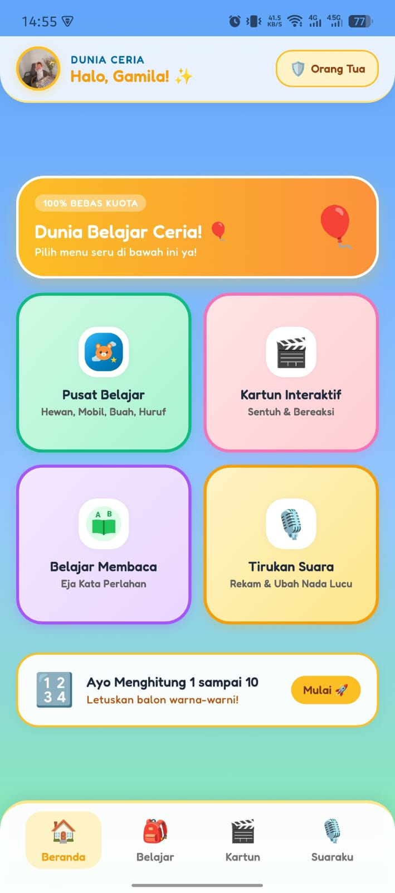
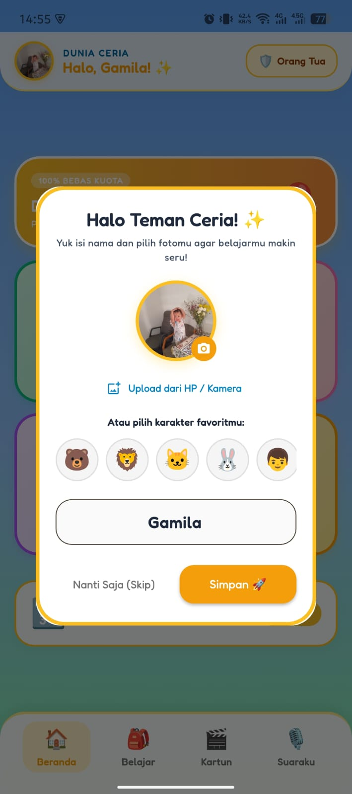
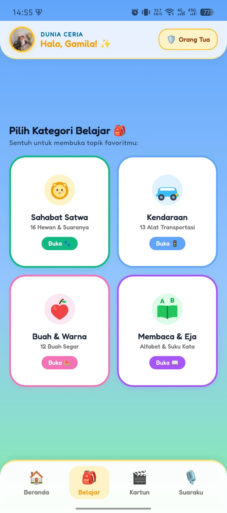
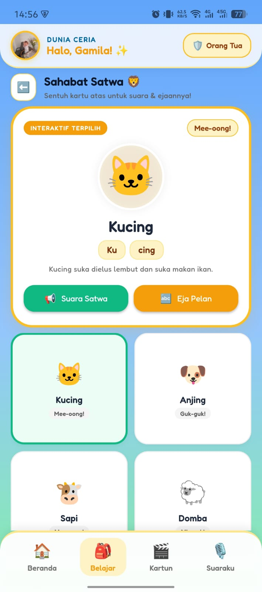
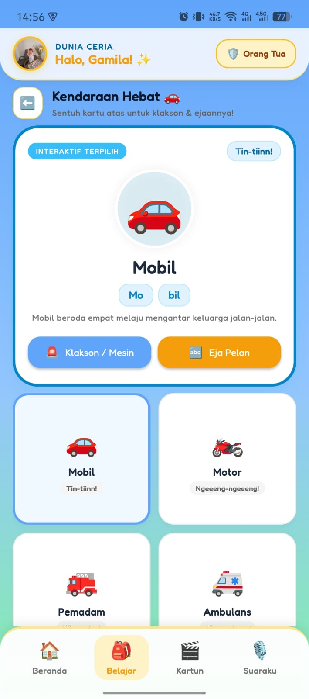
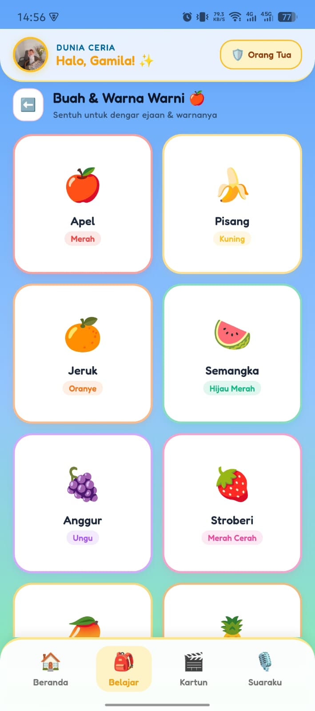
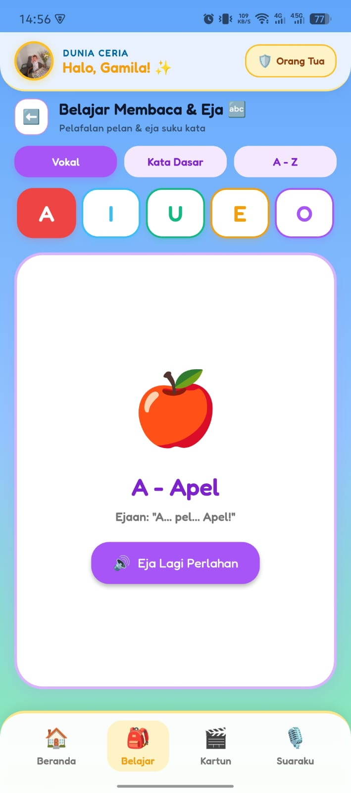
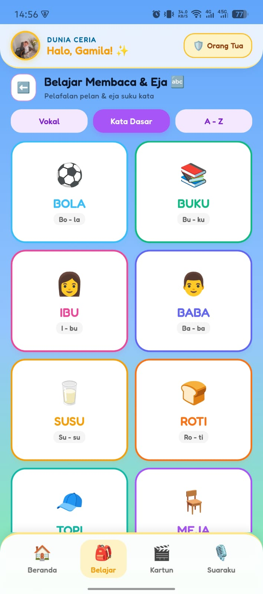
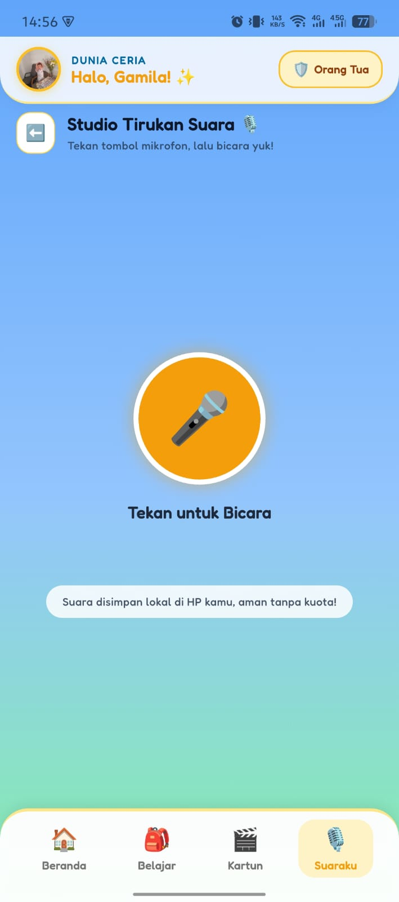
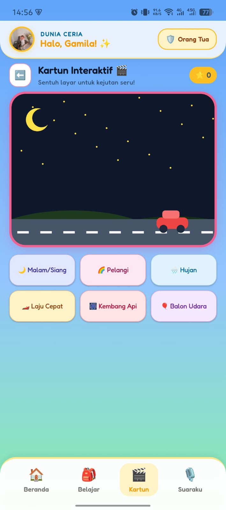

# 🎈 Dunia Anak Ceria — Kids Launcher & Early Childhood Learning App

[](https://flutter.dev)
[](https://dart.dev)
[](#)
[](#)
[](#)

> **"Ruang Digital Aman, Edukatif, dan Ramah Balita untuk Generasi Emas Indonesia."**

**Dunia Anak Ceria** adalah aplikasi *Interactive Kids Kiosk Launcher* dan pusat edukasi dini yang dirancang khusus untuk anak usia **1 hingga 5 tahun**. Menggabungkan konsep **Android Kiosk Mode** (sebagai launcher utama pengunci layar) dengan metode belajar **Stage Card Pattern & Slow Phonics Engine**, aplikasi ini menjamin anak belajar mandiri dengan aman tanpa risiko mengakses aplikasi sensitif orang tua maupun terpapar konten yang tidak sesuai.

---

## 👶 Mengapa Aplikasi Ini Sangat Baik untuk Anak Usia 1–5 Tahun?

Masa usia 1–5 tahun merupakan **Golden Age (Periode Emas)** di mana 80% perkembangan koneksi sinapsis otak anak terbentuk. Aplikasi ini dirancang berdasarkan prinsip psikologi perkembangan anak dan ergonomi balita:

### 1. Mencegah Speech Delay melalui *Slow Phonics Engine*
Balita belajar bahasa dari pemisahan artikulasi suara suku kata. Fitur ejaan kami melafalkan kata perlahan dengan suku kata terpisah (contoh: *"Mo... tor... Motor!"* atau *"I... bu... Ibu!"*) menggunakan Voice Bahasa Indonesia asli dan tempo ramah anak (`rate: 0.32 - 0.38`), membantu menstimulasi kemampuan wicara aktif anak.

### 2. Membangun Fokus dengan *Stage Card Pattern*
Rentang konsentrasi balita (*attention span*) hanya berkisar 3–5 menit. Tata letak **Panggung Interaktif Besar** di atas dan **Daftar Pilihan** di bawah melatih fokus mata balita pada satu objek aktif tanpa distraksi menu rumit.

### 3. Visual Ergonomis & Bebas Konten Adiktif (*Anti-Brainrot*)
Bebas 100% dari video vertikal bergulir cepat (*short-form addiction*), bebas iklan, dan bebas kuota internet. Palet warna didasarkan pada studi psikologi warna pastel cerah yang menyenangkan mata tanpa membuat mata anak lelah.

### 4. Perlindungan Screen Time Otomatis
Dilengkapi timer batas waktu layar (*15, 30, 45, 60 menit*). Begitu waktu habis, aplikasi menampilkan layar tidur berbintang ramah balita agar anak terbiasa disiplin meletakkan gadget tanpa tantrum.

---

## 🌟 Keunggulan Utama Aplikasi

| Keunggulan | Penjelasan Teknis & Manfaat |
|---|---|
| 🛡️ **Kiosk Mode & Pinning** | Mengunci tombol Home dan Recent Apps Android melalui `startLockTask()` sehingga anak tidak bisa keluar ke WhatsApp, YouTube umum, galeri, atau pengaturan HP. |
| 📴 **100% Offline-First** | Seluruh aset gambar vektor, 33 efek suara berkualitas tinggi, dan TTS tersimpan lokal. Bebas kuota internet dan aman dibawa bepergian. |
| 🧑‍🎨 **Personalisasi Avatar & Nama** | Menyapa anak secara personal (*"Halo, Arkan! ✨"*) dengan foto anak sendiri atau pilihan karakter satwa favorit. |
| 🔤 **Kurikulum Membaca Bertahap** | Belajar bertahap dari Huruf Vokal (*A-I-U-E-O*), Kata Dasar Dua Suku Kata (*IBU, BABA, BOLA, BUKU*), hingga Alfabet Lengkap *A–Z*. |
| 📐 **Desain Responsif Adaptif** | Tampilan otomatis menyesuaikan layar HP (Portrait) maupun Tablet / iPad (Landscape dual-panel split screen). |
| 🔐 **Parental Gate Interaktif** | Akses ke pengaturan sistem dilindungi soal hitungan matematika acak agar tidak bisa ditembus oleh balita. |

---

## 📸 Galeri Fitur & Antarmuka Aplikasi

Berikut adalah dokumentasi tampilan nyata dari fitur-fitur utama di dalam aplikasi **Dunia Anak Ceria**:

### 1. Beranda Utama & Personalisasi Profil Anak
| Beranda Ceria (Dashboard) | Popup Input Nama & Foto Profil |
|:---:|:---:|
|  |  |
| *Bebas kuota, menu modul besar, dan sapaan personal untuk anak.* | *Input nama balita, pilih foto dari galeri/kamera, atau pilih karakter satwa.* |

---

### 2. Pusat Belajar & Eksplorasi Pengetahuan
| Menu Pusat Belajar (Learn Hub) | Sahabat Satwa (16 Hewan) |
|:---:|:---:|
|  |  |
| *Pintu masuk ke kategori Hewan, Transportasi, Buah, dan Membaca.* | *Panggung interaktif suara asli satwa & pelafalan ejaan lambat.* |

---

### 3. Kendaraan & Buah Segar
| Kendaraan Hebat (13 Transportasi) | Buah Segar & Pengenalan Warna |
|:---:|:---:|
|  |  |
| *Bunyi klakson mobil, motor, sirine pemadam, hingga roket angkasa.* | *Mengenal 12 buah segar, rasa manis/segar, dan warna pelangi.* |

---

### 4. Belajar Membaca & Ejaan Suku Kata
| Belajar Huruf Vokal (A-I-U-E-O) | Belajar Kata Dasar (IBU, BABA, BOLA) |
|:---:|:---:|
|  |  |
| *Pelafalan fonik vokal interaktif berpasangan dengan contoh objek.* | *Latihan membaca dua suku kata dengan jeda bunyi natural.* |

---

### 5. Stimulasi Kreativitas & Interaksi
| Studio Tirukan Suara (Perekam Lucu) | Kartun Interaktif (Sentuh Kanvas) |
|:---:|:---:|
|  |  |
| *Rekam celoteh anak dan dengarkan kembali dengan nada kelinci imut.* | *Sentuh langit siang/malam, letuskan awan hujan, dan lajukan mobil.* |

---

## 🛠️ Tech Stack & Arsitektur Perangkat Lunak

Dibangun dengan arsitektur **Clean & Feature-First** untuk skalabilitas, performa tinggi, dan *zero memory leak*:

```text
lib/
├── core/
│   ├── constants/        # AppColors, AppData (Dataset Satwa, Mobil, Buah, Kata)
│   ├── services/         # SoundEngine, KioskService, UserProfileService, AudioRecorderService
│   └── theme/            # AppTheme, Tipografi Google Fonts (Fredoka & Nunito)
├── features/
│   ├── animals/          # Sahabat Satwa Screen & Sub-widgets
│   ├── vehicles/         # Kendaraan Screen & Audio Controller
│   ├── fruits/           # Buah & Warna Screen
│   ├── reading/          # Modul Eja Vokal, Kata Dasar, Alfabet A-Z
│   ├── numbers/          # Modul Berhitung Balon 1-10
│   ├── voice_mimic/      # Studio Rekaman Audio Lokal + Pitch Shift Playback
│   ├── interactive_cartoon/ # Custom Painter Scene Siang/Malam Interaktif
│   ├── parental_gate/    # Kiosk Settings Modal & Verifikasi Matematika
│   └── home/             # Dashboard, Bottom Nav, dan UserProfileDialog
└── shared/
    └── widgets/          # BouncyCard, TopKioskBar, ResponsiveStageLayout
```

### Rincian Dependensi Utama:

* **Framework & Bahasa**: Flutter `3.35.7` (Dart `3.5+`) via FVM (*Flutter Version Management*).
* **State Management**: `flutter_riverpod: ^2.5.1` & `ListenableBuilder` reaktif.
* **Audio & Phonics**:
  * `audioplayers: ^6.7.1` — Pemutaran SFX latensi rendah dari memori lokal.
  * `flutter_tts: ^4.2.5` — Text-to-Speech sintetis terkonfigurasi engine `com.google.android.tts` dengan locale `id-ID`.
  * `record: ^5.2.1` & `path_provider: ^2.1.5` — Perekam suara mikrofon lokal.
* **UI & Grafis Vektor**:
  * `flutter_svg: ^2.0.10+1` — Rendering grafis vektor resolusi tajam bebas pecah di tablet HD.
  * `google_fonts: ^6.3.3` — Tipografi anak bersudut tumpul ramah mata (*Nunito & Fredoka*).
  * `image_picker: ^1.2.2` — Pemilihan foto anak dari galeri dan kamera perangkat.
* **Penyimpanan Lokal**: `shared_preferences: ^2.5.5` — Penyimpanan offline instan profil anak, durasi screen time, dan status kiosk.
* **Integrasi Native Android (Kotlin)**:
  * `MethodChannel` (`com.duniaanak.ceria/kiosk`) — Menghubungkan tombol UI dengan API Android `startLockTask()` dan `Settings.ACTION_HOME_SETTINGS`.
  * `AndroidManifest.xml` — Kategori `android.intent.category.HOME` & `android.intent.action.TTS_SERVICE`.

---

## 🚀 Memulai (Instalasi & Menjalankan)

### 1. Prasyarat Sistem
* Flutter SDK (Direkomendasikan via [FVM](https://fvm.app/)): Versi `3.35.7`.
* Android Studio / Xcode untuk emulator dan toolchain Android SDK API 21–35.
* Perangkat HP / Tablet Android atau Simulator iOS.

### 2. Langkah Menjalankan Project

1. **Clone repository ini**:
   ```bash
   git clone https://github.com/username/dunia_anak_ceria.git
   cd dunia_anak_ceria
   ```

2. **Gunakan Flutter via FVM**:
   ```bash
   fvm use 3.35.7
   fvm flutter pub get
   ```

3. **Generate Launcher Icons (Opsional)**:
   ```bash
   fvm dart run flutter_launcher_icons
   ```

4. **Jalankan Unit & Widget Test**:
   ```bash
   fvm flutter test
   ```

5. **Jalankan Aplikasi ke Perangkat**:
   ```bash
   # Jalankan di Android terhubung (Wireless / USB)
   fvm flutter run

   # Atau jalankan di Chrome Web untuk inspeksi cepat
   fvm flutter run -d chrome
   ```

---

## 🔒 Panduan Kiosk Mode untuk Orang Tua

1. **Menjadikan Launcher Permanen**:
   * Buka aplikasi ➡️ Sentuh tombol **`Orang Tua 🛡️`** di kanan atas ➡️ Jawab soal matematika.
   * Pilih menu **"Jadikan Launcher Utama HP"** (Sentuh tombol **`Atur ⚙️`**).
   * Pada menu Pengaturan Android, pilih **Dunia Ceria** sebagai *Aplikasi Layar Utama (Default Home App)*.
2. **Kunci Layar Kiosk (Screen Pinning)**:
   * Aktifkan sakelar **"Kunci Layar Kiosk (Pinning)"** agar tombol notifikasi dan navigasi bawah terkunci total saat anak bermain.
3. **Keluar Kembali ke Android Normal**:
   * Masuk ke **Zona Orang Tua** dengan menyelesaikan perhitungan matematika.
   * Tekan tombol merah **"Keluar ke Launcher Sistem"** untuk mengembalikan HP ke tampilan normal orang tua.

---

<p align="center">
  Dibuat dengan ❤️ untuk anak-anak Indonesia • <b>Dunia Anak Ceria</b>
</p>
